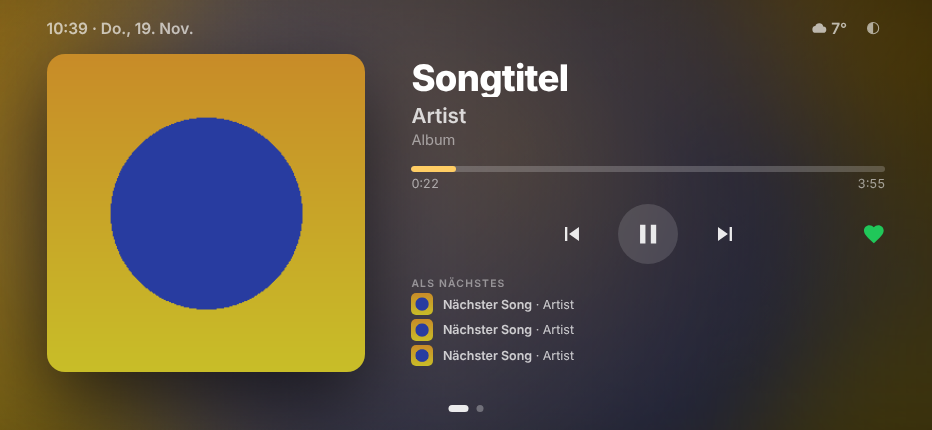
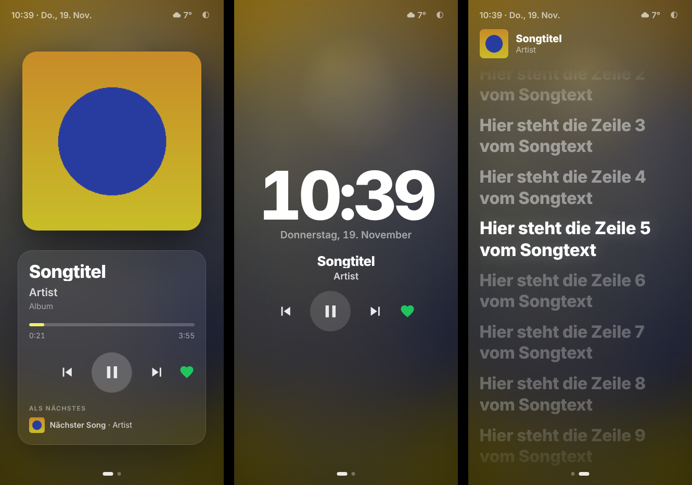

# Now Playing

Eigene "Now Playing"-Ansicht für Spotify. Hab ich gebaut, um mein iPhone zu Hause quer hinzustellen, während Musik läuft.

Läuft als Web-App direkt im Browser, kein App Store nötig.

## Features

- Cover, Titel und Fortschritt vom aktuellen Song
- Play/Pause, Skip und Vorspulen per Finger
- Lyrics synchron zum Song (nach links wischen)
- Themes: Standard, Glas, Vinyl und Uhr (hoch/runter wischen)
- Hintergrundfarben passen sich dem Cover an
- Leichter Parallax-Effekt, wenn man das Handy bewegt
- Warteschlange, Like-Button, Wetter und Nachtmodus

## Selbst nutzen

1. Im [Spotify Developer Dashboard](https://developer.spotify.com/dashboard) eine App anlegen (Web API) und die eigene URL als Redirect URI eintragen
2. Repo forken und GitHub Pages aktivieren
3. Seite öffnen, beim ersten Start die eigene Client ID eingeben und verbinden
4. In Safari über Teilen → "Zum Home-Bildschirm" hinzufügen

Spotify Premium ist nötig. Lyrics kommen von [lrclib.net](https://lrclib.net), das Wetter von [Open-Meteo](https://open-meteo.com).
